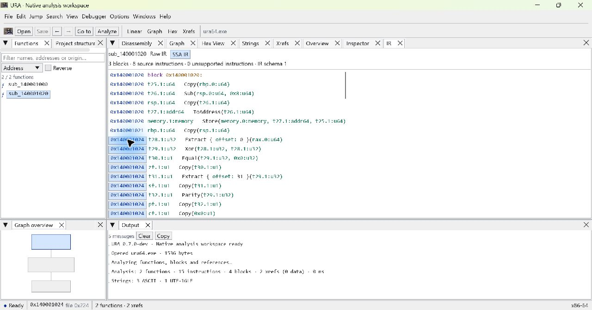
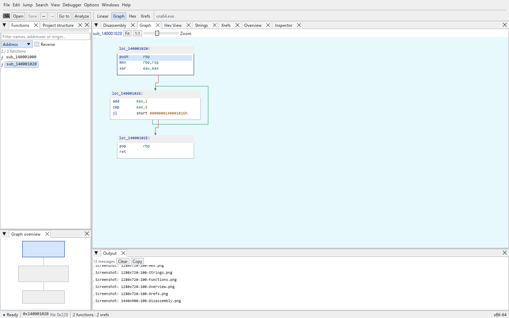
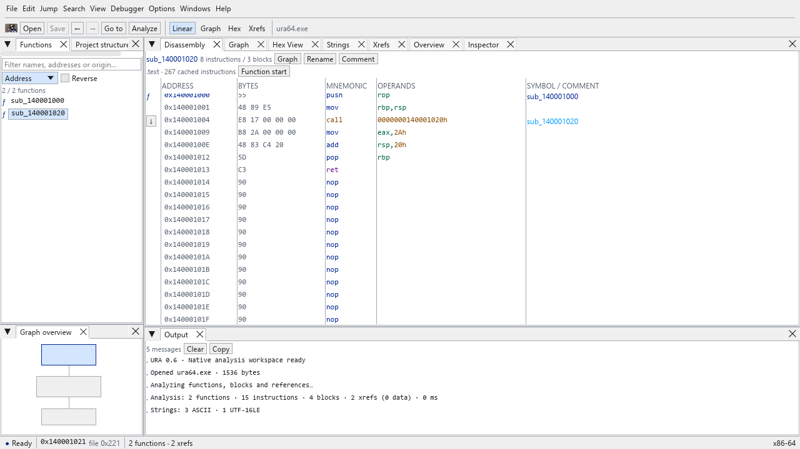
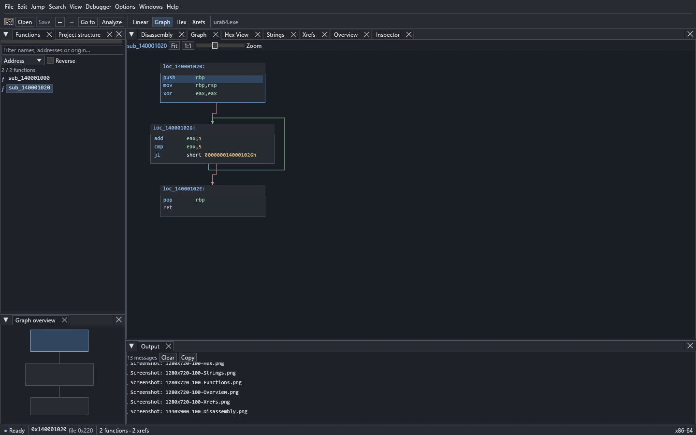

<p align="center"></p>

# URA

Ultimate Reverse Engineer

Public prerelease: [`v0.8.0-dev`](https://github.com/entrenchedosx/URA/releases/tag/v0.8.0-dev)
from commit `1194403`. Current `v0.8-decompiler-foundations` source contains later audit repairs that are not in that ZIP. The complete v0.8 checklist remains unfinished; see the [checklist audit](docs/AUDIT-0.8.md).
High-level output is experimental and variable idle CPU remains an unexplained
known limitation; see [v0.8 verification](docs/VERIFICATION-0.8.md) and
[decompiler design](docs/DECOMPILER.md).

The latest [v0.8 finalisation checkpoint](docs/FINALISATION-0.8.md) adds a
self-contained typed tree, conservative postdominator joins, bounded parameter
type demands and trusted PE import binding. CLI `highlevel --json --ast` and MCP
`ura_get_high_level_ir` with `ast: true` expose the tree. Full release acceptance
remains pending; the existing public ZIP has not been replaced.

## Overview

URA is a native Rust static-analysis workbench for executable files. The desktop,
CLI and MCP server use the same analysis engine. Samples are read locally and
are never executed by URA. This is an early engineering release, with explicit
analysis limits; it is not a replacement for the full feature sets of IDA or Ghidra.

## Current capabilities

- Executable metadata, SHA-256 identity, sections, symbols, imports and exports.
- x86/x64 linear disassembly with bytes, flow classification and direct targets.
- Recursive function discovery from entry points, exports, symbols and calls.
- Basic blocks, conditional/loop edges and incoming/outgoing code references.
- Data references for provable RIP-relative and absolute memory operands.
- ASCII/UTF-16LE strings and bounded hex reads.
- SQLite projects with annotations, name overrides, manual function starts,
  navigation history and saved workspace state.
- Typed raw/SSA IR for a tested scalar x86/x64 subset, with explicit unknown effects.
- Dominators/frontiers, phi nodes, def-use counts, conservative constants and dead definitions.
- Narrow guarded absolute/relative jump-table patterns and tail/thunk candidates.
- Evidence-based ABI/signature recovery, physical stack frames and conservative types.
- Bounded interprocedural call graph and experimental C-like high-level rendering.
- Native CLI with text/JSON output and a local stdio MCP server with 30 tools.

High-level output is a structural view of verified SSA, not reconstructed source,
and is not claimed to compile. There is no debugger, PDB/C++ loader or public
plugin API. Indirect transfers remain open, including transfers with heuristic
recovered edges. Discovery is conservative and can miss code, reject ambiguous
seeds or stop at limits.

## Supported architectures and executable formats

| Input | Support |
|---|---|
| PE, ELF, Mach-O | Metadata and section-based inspection through `object` |
| x86 and x86-64 | Decoding and function/CFG analysis |
| ARM, AArch64, RISC-V, MIPS, PowerPC and other recognized CPUs | Metadata only; no instruction analysis |

PE and ELF x64 fixtures and Windows system binaries are exercised by tests.
Mach-O and other host operating systems need broader validation. Maximum input
size is 512 MiB; resources are also bounded during analysis and string scanning.

## Desktop application

The default application uses eframe, egui and OpenGL. It has no WebView dependency.
Compact native menus and docking provide Functions, Project structure,
Disassembly, Graph, Hex View, Strings, Xrefs, Overview, Inspector, Output,
Graph overview, Function signature, Stack frame, Types, Call graph and
Analysis inspector panels. Project structure includes sections, symbols, imports
and exports. Imports without mapped addresses are informational.

The Function signature, Stack frame, Types, Call graph and Analysis inspector
panels follow the selected function. They show evidence, confidence, conflicts
and hard-bound truncation, and addresses navigate back to disassembly.
The desktop edits signatures, physical stack-slot names/types and user structures/unions/aliases. Open a project to save edits; double-click a stack name or right-click for references. Schema v5 preserves these overrides separately from inference. CLI and MCP expose matching guarded writes. Recovered high-level text is
explicitly labelled experimental and is not source code.

Open the optional **IR** panel from Windows or search `IR` in Ctrl+K. It follows
the selected function, offers Raw IR / SSA IR, and links operation addresses back
to source instructions. It stays hidden in the default layout. Exact coverage,
memory/call assumptions and function budgets are in [IR-DESIGN.md](docs/IR-DESIGN.md).

Classic light and professional dark themes share one rendering implementation.
Preferences control interface/code/graph fonts, row height, bytes and panel
visibility. Tabs can be moved, closed and reopened from Windows; reset restores
the default layout. The graph uses actual analysis blocks, with pan, zoom, fit,
selection and an interactive overview. Large graphs are capped at 240 displayed
blocks and 32 displayed instructions per block; truncation is shown explicitly.

## Building from source

Windows x64 is the verified host. Install Rust with the MSVC toolchain and Visual
Studio C++ build tools/Windows SDK. The native crate declares Rust 1.95 or newer;
this iteration was verified with Rust 1.99.1. Build dependencies may require a
newer compiler than the older core-crate minimum.

```powershell
cargo build --release -p ura-native -p ura-cli -p ura-mcp
cargo run --release -p ura-native -- path/to/sample.exe
```

Generated icons are committed. Regeneration requires Python and Pillow:

```powershell
python scripts/generate_icons.py
```

Create the portable Windows archive after the Release build with
`./scripts/package-windows.ps1 -Version 0.8.0-dev`. It checks all three executable
version/product resources, writes per-file checksums, collects dependency license
texts (including bundled font notices) and emits a SHA-256 sidecar for the ZIP.
Publishing the archive is a separate release step.

## Usage

Open a binary with Ctrl+O or pass its path at startup. Analysis and string
scanning run in a background worker. Create a project with Ctrl+N to persist
comments, renamed functions and manual starts. The Inspector edits annotations;
F2 renames a function. Save/reopen retains analysis seeds and view state;
analysis results themselves are recomputed.

| Shortcut | Action |
|---|---|
| Ctrl+G / Ctrl+K | Address, symbol, offset or command navigation |
| Alt+Left / Alt+Right | Navigation history |
| Space | Switch linear disassembly and graph |
| Arrow / PageUp / PageDown | Select an instruction in the linear view |
| Enter | Follow selected direct branch/call |
| Ctrl+S | Save project workspace |
| Ctrl+, | Preferences |
| Alt+F/E/J/S/V/D/O/W/H | Open the corresponding top menu |

Addresses are hexadecimal, with an optional `0x` prefix. Desktop navigation also
accepts `@200` file offsets, relative deltas and expressions such as `.text+10`.

## Headless CLI

The CLI does not start a GUI. Paths must resolve inside `--allow` roots; the
default root is the current directory. Use repeatable `--allow DIR` for samples
elsewhere. Commands are `info`, `analyze`, `functions`, `disasm`, `strings`,
`xrefs`, `cfg`, `ir`, `dominators`, `diagnostics`, `signature`, `stack`, `types`,
`callgraph`, `highlevel` and `hex`.

```powershell
ura-cli info sample.exe --json
ura-cli functions sample.exe --limit 50 --sort name --json
ura-cli disasm sample.exe --address 140001000 --count 20 --json
ura-cli cfg sample.exe --function 140001020 --json
ura-cli ir sample.exe --function 140001020 --limit 50 --json
ura-cli ir sample.exe --function 140001020 --ssa --offset 50 --limit 50 --json
ura-cli dominators sample.exe --function 140001020 --json
ura-cli diagnostics sample.exe --function 140001020 --json
ura-cli signature sample.exe --function 140001020
ura-cli stack sample.exe --function 140001020 --json
ura-cli types sample.exe --function 140001020
ura-cli callgraph sample.exe --function 140001000 --depth 1 --json
ura-cli highlevel sample.exe --function 140001020 --limit 50
ura-cli hex sample.exe --offset 200 --length 32 --json
ura-cli functions sample.exe --project analysis.ura --json
```

JSON responses carry `schemaVersion: 1`; addresses are strings. Operation errors
use a structured error object and exit code 1. Invalid command-line syntax uses
Clap's usage errors. `--help` documents per-command limits. The CLI reads project
names, manual starts and type/signature overrides without migrating the database.
Create projects through the desktop or MCP. CLI signature, stack-variable and
type-library edits require `--enable-writes` and an existing `--project`; use
`set-signature --input FILE`, `set-variable-type --function ADDRESS --offset OFFSET`,
or `type-library --import FILE`. Definition files use the shared structured
signature/type model and are limited to 1 MiB.
Analysis commands accept instruction/function/block limits, `--no-follow-calls`
and `--no-symbol-seeds`. IR pages include `irVersion:1`, binary identity, normalized
analysis options, source operations and the variable definitions referenced by the
page. Requests exceeding a function's IR budget return an explicit error.
Decompiler commands report evidence, conflicts, confidence and truncation; the
high-level command is explicitly labelled experimental.

## MCP integration

Configure an MCP client to start `ura-mcp` with stdio transport:

```json
{
  "mcpServers": {
    "ura": {
      "command": "C:/tools/URA/ura-mcp.exe",
      "args": ["--allow", "C:/samples"]
    }
  }
}
```

Call `ura_open_binary`, retain the returned handle, call `ura_analyze`, then query
`ura_get_binary_info`, `ura_get_functions`, `ura_get_function`,
`ura_get_disassembly`, `ura_get_cfg`, `ura_get_xrefs`, `ura_search_strings` or
`ura_read_bytes`. Close handles with `ura_close_binary`.

After analysis, `ura_get_ir`, `ura_get_ssa`, `ura_get_dominators` and
`ura_get_analysis_diagnostics` take `handle`, `function`, optional `offset` and
`limit`. IR/diagnostic pages allow 1–500 rows; dominator pages allow 1–200.
Decompiler queries are `ura_get_function_signature`,
`ura_get_calling_convention`, `ura_get_stack_variables`, `ura_get_types`,
`ura_get_structure`, `ura_get_call_graph`, `ura_get_type_constraints` and
`ura_get_high_level_ir`. Overrides use `ura_set_function_signature`, `ura_set_variable_type` and `ura_set_type_library`. `ura_get_types` without `function` reads the project type library. `ura_get_structure` now takes `handle` and `name` and returns a real structure/union definition; the original high-level alias is superseded by `ura_get_high_level_ir`. CLI equivalents include `type-library --name NAME` and `type-library --import FILE`.
`ura_get_function` returns at most 500 blocks per call (`maxBlocks`, default 200)
plus at most 1000 callers/callees, and reports `blocksTruncated`,
`callersTruncated` and `calleesTruncated` when more exist. Requests reuse a
verified least-recently-used function cache, invalidated by reanalysis. At most
eight binary handles and two IR bundles per handle are retained.

`ura_save_project`, `ura_rename_function`, `ura_add_comment`,
`ura_export_analysis`, `ura_set_function_signature`, `ura_set_variable_type` and `ura_set_type_library`
require the explicit `--enable-writes` process option. Signature, stack and type-library
overrides also require that the target project is attached to the binary.
No network listener is started. Stdout contains MCP JSON only; logs go to stderr.
Read-only project attachments support schema v1-v5 without migration or following
the database's recorded binary path. The opened binary's SHA-256 must match.
Allowed roots constrain resolved paths, but are not an operating-system sandbox
against a concurrent local attacker changing files or links.

## Screenshots

Actual captures of URA's native renderer, using the deterministic regression
fixture (not simulated analysis):

The development IR view below was captured at Windows OS 150% scale:









See [verification](docs/VERIFICATION-0.8.md) for sizes, scaling and remaining
manual checks. The small fixture verifies known instructions and loop edges;
real Windows binaries were inspected separately.

## Project structure and architecture

| Path | Responsibility |
|---|---|
| `crates/ura-core` | Loading, decoding, functions, CFGs, references, strings, IR, decompiler foundations |
| `crates/ura-project` | SQLite persistence and compatible migrations |
| `crates/ura-native` | Native desktop and background worker |
| `crates/ura-service` | Shared headless sessions, DTOs and path/write policy |
| `crates/ura-cli` | Native command-line interface |
| `crates/ura-mcp` | MCP stdio adapter |
| `tests/fixtures`, `scripts` | Reproducible fixtures, icons and measurements |
| `src`, `src-tauri` | Retained legacy UI for migration comparison |

The desktop calls core/project directly; CLI/MCP share the service adapter over
the same core/project implementation. No analysis engine is duplicated. The
legacy frontend remains for comparison and is not required by the native build.
See [architecture](docs/ARCHITECTURE.md) and [recovery](docs/RECOVERY-2026-10-20.md).

## Testing

```powershell
cargo fmt --check
cargo clippy --workspace --all-targets -- -D warnings
cargo test --workspace
cargo build --workspace --release
```

Tests cover deterministic PE/ELF decoding, malformed input, CFG/reference
behavior, verified IR/SSA, ABI/stack/type/call-graph recovery, database
migrations and annotation persistence, service restrictions, CLI processes,
actual MCP handshakes/tool calls, and native-panel tessellation. Renderer checks
are opt-in; see [v0.8 verification](docs/VERIFICATION-0.8.md) and the
[v0.6 historical measurements](docs/VERIFICATION-0.6.md).

## Roadmap

Priorities are closing the idle-CPU blocker, expanding semantic/ABI validation,
relocation/import references and broader compiler-pattern recovery. Type inference
and structured control flow must precede decompilation. See the
[Ghidra source study and feature matrix](docs/GHIDRA-RESEARCH.md) for dependencies,
complexity and verification strategies. Multi-monitor DPI, cross-platform input
and broader executable-format coverage remain follow-ups.

## Contributing

Keep engine code independent of GUI types, preserve existing project schemas,
and add deterministic regression coverage for correctness changes. Run the
workspace checks above. Do not commit proprietary samples, credentials or local
analysis projects. Discuss new architectures and persistence changes before
introducing a new format or dependency.

## License and third-party notices

URA retains its [MIT license](LICENSE). Dependencies retain their own licenses;
see [third-party notices and release generation](THIRD_PARTY.md).
The original `icon.webp` is the user-supplied official artwork; its owner confirmed
permission to redistribute it with URA. Native variants preserve the full image.
No IDA artwork or source is included; Ghidra was studied as a reference only.
